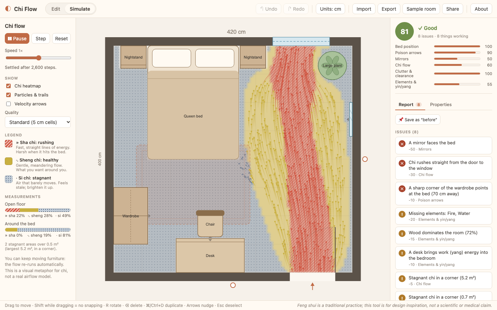
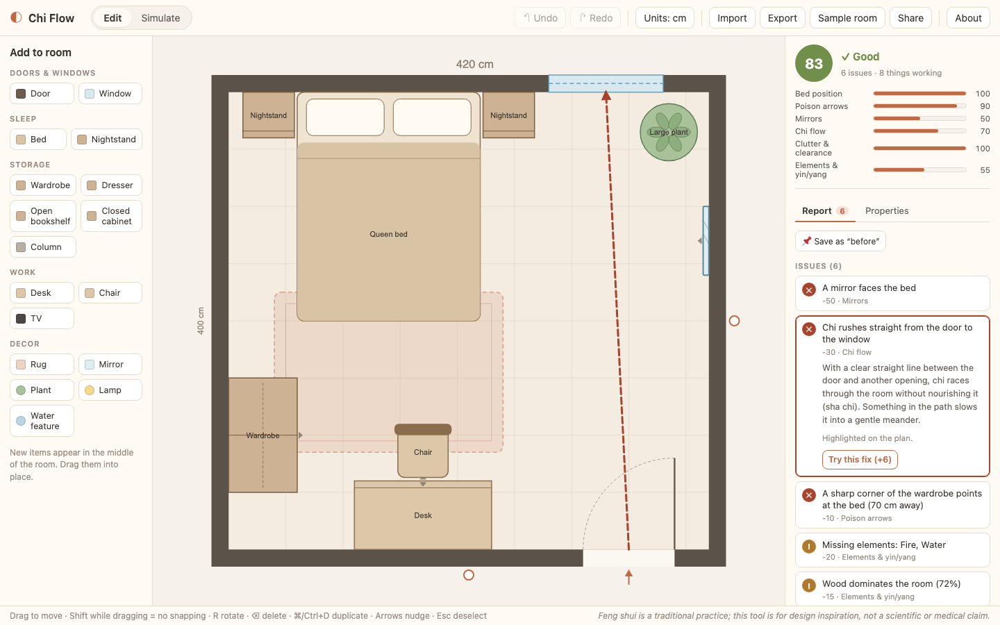
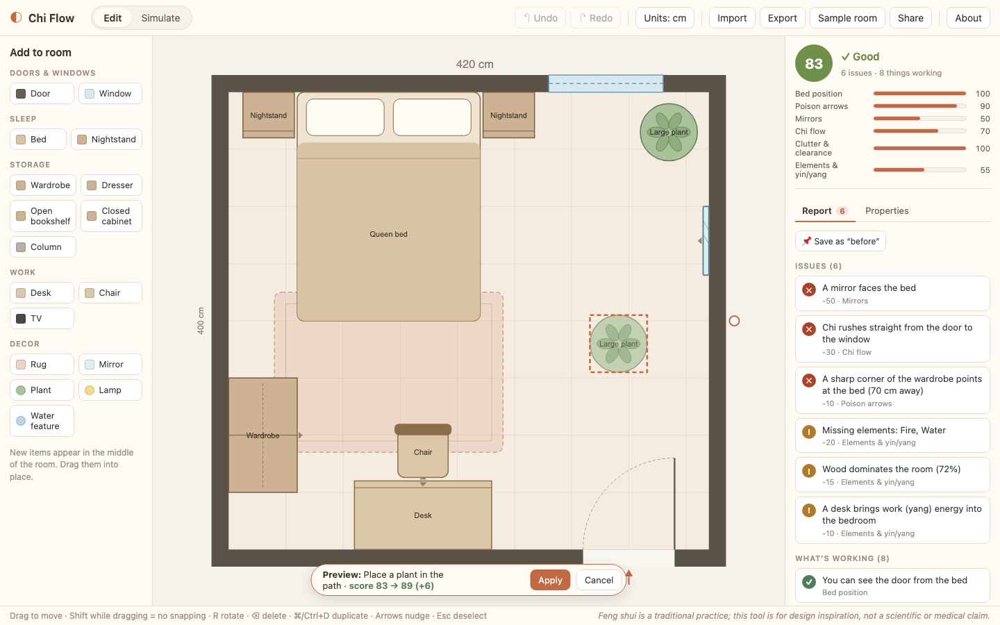
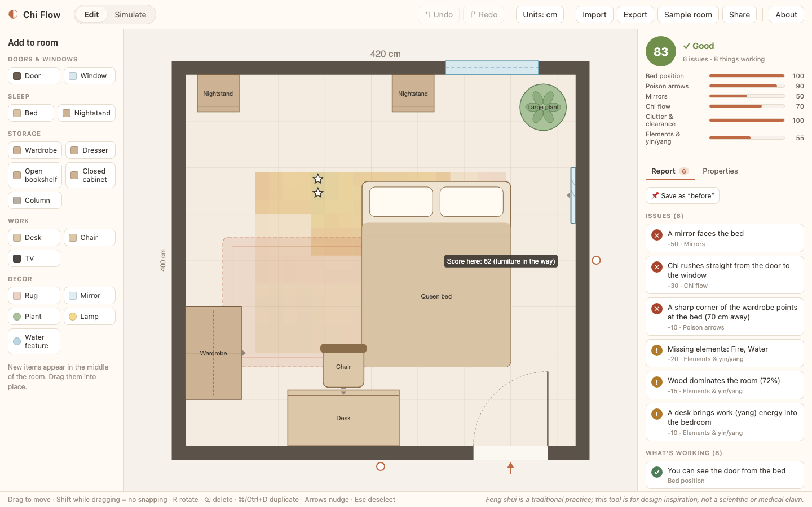

# Chi Flow · feng shui bedroom simulator

Draw your bedroom, watch **chi flow through it like a wind tunnel**, and get a feng shui report that explains what's working, what isn't, and how to fix it, with one-click fixes.

**[▶ Live demo](https://YOUR-GITHUB-USERNAME.github.io/chi-flow/)** · [Open straight into the simulation](https://YOUR-GITHUB-USERNAME.github.io/chi-flow/?mode=simulate)



## Features

- **Room editor.** Rectangular or L-shaped rooms with real dimensions (metric or imperial), doors and windows that slide along the walls, and 15 kinds of furniture. Drag, rotate and resize with snapping, and use undo/redo and keyboard shortcuts.
- **Chi flow simulation.** A Lattice Boltzmann fluid solver runs in a Web Worker. Chi enters through the main door and leaves through open windows. Tracer particles leave fading trails, and the floor is shaded by chi type: rushing **sha**, healthy **sheng** and stagnant **si**. Each type also has its own pattern, so the map never relies on colour alone.
- **Feng shui report.** Seven Western (BTB / form school) rules give a 0–100 score: the bed's commanding position, poison arrows, mirrors, chi flow, clutter and clearance, the five elements and yin/yang, and the bagua map.
- **Click to highlight.** Each issue draws its cause on the plan: the line of sight, the sharp corner's "arrow", the mirror's reflection, or the walking path.
- **Try this fix.** Previews the suggested change as a ghost with the score it would get. Applying it is a single undoable step.
- **Best-spot heatmap.** While you drag the bed or desk, the floor is shaded by the score each position would earn.
- **Before/after.** Save a snapshot and compare plans and scores side by side.
- **Saving and sharing.** Autosave, JSON import/export, and share links that pack the whole room into the URL. There's no server or account, and nothing leaves your browser.

| Click an issue to see its cause | Preview a fix before applying it | Best spot while dragging the bed |
| --- | --- | --- |
|  |  |  |

## How the simulation works

Chi Flow uses the **Lattice Boltzmann method (LBM)**, a way of simulating fluids that's popular because it is simple and runs fast.

1. **Grid.** The room becomes a grid of 5 cm cells, or 2.5 cm in high quality. Walls and solid furniture block flow. Plants and chairs are porous and slow it down. Rugs are ignored.
2. **Nine directions per cell.** Each cell stores how much "fluid" is moving in each of 9 directions: staying still, 4 straight and 4 diagonal. This is called **D2Q9**.
3. **Collide, then stream.** Each step, every cell nudges its 9 values towards a balanced equilibrium for its current density and velocity (the **BGK** collision). Then each value hops to the neighbouring cell in its direction. Values that hit a wall bounce straight back, which gives no-slip walls.
4. **Boundaries.** The main door is a velocity inlet. Open windows and other doors are pressure outlets. If the door is the only opening, half the doorway breathes in and half breathes out.
5. **Classification.** Once the flow settles, each floor cell is classed by its speed relative to the inlet: sha above 60%, si below 8%, sheng in between. The rule engine uses the share of each class, the mix around the bed, and any stagnant patches larger than 0.5 m².

Averaged over thousands of cells and steps, these local rules behave like a real fluid, so you get jets, wakes and recirculation. The solver runs in a **Web Worker** (a background thread), so the page stays smooth. Viscosity is scaled with cell size, so both quality settings give the same picture.

> The simulation is a **visual metaphor** for chi, not a model of real airflow.

## How the score works

Each rule is a pure function from the layout to a list of findings. A finding has a status, a score impact, an explanation, the shapes to highlight, and optionally a fix. Every category starts at 100, and the overall score is the weighted average of the categories:

| Category | Weight | What it checks |
| --- | --- | --- |
| Bed position | 35 | Seeing the door from the pillow, the "coffin position", a solid wall behind the head, diagonal placement, windows, door swing, clearance on both sides, matching nightstands (plus a half-weight desk check) |
| Poison arrows | 15 | Rays from sharp corners (furniture, L-shaped walls, columns) towards the bed, open shelves, tall nightstands |
| Mirrors | 10 | Mirrors that reflect the bed or hang over it |
| Chi flow | 20 | A straight rush from the door to a window, plus sha around the bed, stagnant areas and the share of sheng from the simulation |
| Clutter & clearance | 10 | Floor coverage, and a 75 cm walkway found with a breadth-first search over a clearance map |
| Elements & yin/yang | 10 | Five-element balance by count and area, cycle tips, and yang items like TVs and desks |
| Bagua | info | The 3×3 bagua grid, oriented to the entrance, including missing areas in L-shaped rooms |

Labels: **85+ Harmonious**, 70–84 Good, 50–69 Needs attention, below 50 Unsettled. All thresholds and weights live in [`src/rules/config.ts`](src/rules/config.ts).

## Tech stack

- **TypeScript + Vite**, with no UI framework: the panels are built with plain DOM code.
- **Konva** for the interactive editor layer, and **Canvas 2D** for the heatmap and particles underneath it.
- A **Web Worker** for the LBM solver.
- **Vitest** for unit tests: 130+ tests covering geometry, the rasteriser, the solver, every rule, and the scoring.
- **GitHub Actions** deploys to **GitHub Pages** on every push to `main`.

## Run it locally

You'll need [Node.js](https://nodejs.org/) 20 or newer.

```bash
npm install       # install dependencies
npm run dev       # start the dev server at http://localhost:5173
npm test          # run the unit tests
npm run build     # type-check and build the static site into dist/
npm run preview   # serve the production build locally
```

## Project structure

```
src/
  model/     data types, furniture catalog, layout operations, sample room, validation
  geometry/  vectors, room polygons, rotated rectangles, ray casting, snapping, units
  editor/    Konva editor, drawing, overlays (highlights, ghosts, heatmap, bagua), undo/redo store
  sim/       rasteriser, LBM solver + worker, chi classification, particles, renderer
  rules/     one file per feng shui rule, config, scoring
  report/    report panel, fix preview, best-spot search, before/after
  storage/   autosave, JSON import/export, share links
  ui/        toolbar, palette, properties, simulation panel, About, styles
tests/       Vitest tests mirroring src/
```

The rule engine never touches the screen. The simulation and the rules both read the same plain-JSON `Layout`, and layouts are treated as immutable values, which makes undo/redo and fix previews straightforward.

## Disclaimer

Feng shui is a traditional practice; this tool is for design inspiration, not a scientific or medical claim.
